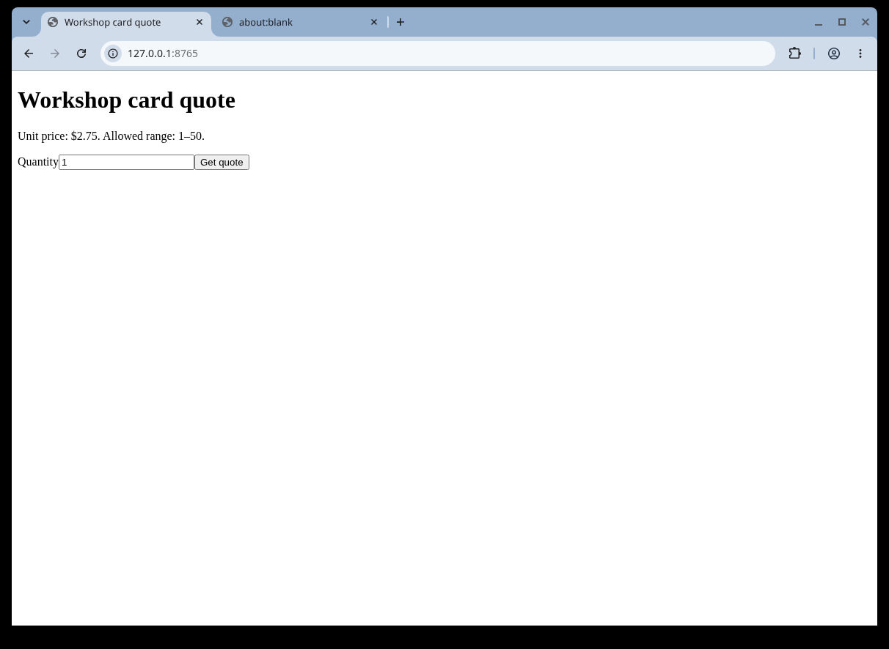

# External development product walk — actual result

PASS for the final workshop quote journeys below. Performed 2026-11-16 around 21:05–21:09 UTC against http://127.0.0.1:8765/ in the existing OpenAI-managed environment. Deployment checkout HEAD independently read as `7fbcbd444c748179ad76220c22c3d0f93f6ad901`. Final provider configuration observed through the live product: 275 cents per card, maximum 50, minimum 1.

The running service command was visible in its process launcher: `PYTHONDONTWRITEBYTECODE=1 python3 toy/native-cycle/web/app.py --provider-path toy/native-cycle/provider --host 127.0.0.1 --port 8765`, with working directory `/workspace/work/p4-native-cycle/deployment`. The service was already running and was left running. No product source, settings, grants, credentials, or pin were changed.

## Method and actual observations

Used the cloud-desktop skill and a real Chromium window. Browser tab creation failed with `Browser Use could not read requirements.` Sky input/state failed with `AT-SPI provider with process ID 23205 is unavailable ... registry reported 0 provider connections`. The documented native `cua.getApp({windowId:27262979})` fallback worked with X11 screenshot observations, coordinate clicks, and native keyboard input. Thus these are actual browser interactions, not simulated handlers or module tests. Accessibility semantics and HTTP status were separately confirmed using an independent Python standard-library urllib HTTP client against the same running service.

| Journey | Actual browser observation | Independent HTTP evidence | Result |
|---|---|---|---|
| Home `/` | Workshop card quote heading; Quantity field default 1; Get quote button; unit price $2.75 and allowed range 1–50 visible | 200; associated label; text input with inputmode numeric, min 1/max 50; GET /quote form | PASS |
| Enter 12 and click Get quote | URL /quote?quantity=12; Your quote; Quantity 12; unit price $2.75; Total $33.00 | 200; quote-result section; submitted field value 12 | PASS |
| Click Start again | Returned to `/`, field 1, no previous result | Home response contains no quote-result | PASS |
| Enter 50 and submit | Quantity 50; Total $137.50 | 200 | PASS |
| Replace with 51 and submit | Enter a whole quantity from 1 to 50; field 51; no total | 400; role=alert; no quote-result | PASS |
| Replace with abc and submit | abc retained in editable field; same current-bounds guidance; no total | 400; value="abc"; no quote-result | PASS |
| Navigate to /quote?quantity=%3Cscript%3E | Literal <script> retained in field; validation message; ordinary usable form, no visible execution/dialog | 400; value="&lt;script&gt;"; response has no script element or executable markup for the supplied tag | PASS for supplied tag |
| Edit rejected value to 2 and submit | Quantity 2; Total $5.50; previous validation text gone | 200; quote-result present; no role=alert | PASS |
| Navigate to /missing | Readable Not found and Start again link, no traceback | 404; href="/" | PASS |
| Click missing-page Start again | Home form restored, field 1 | Home 200 | PASS |
| Additional /quote?quantity=0 and /quote missing parameter | Not visually walked | Both 400; current 1–50 guidance, form usable in HTML, no result; values 0 and empty respectively | PASS, HTTP only |

The HTTP observations were collected at 2026-11-16T21:08:57Z by urllib.request.urlopen with HTTPError bodies/statuses retained. They exercised the actual loopback HTTP service, with no handler imports or internal calls. The escaped-tag finding is scoped to the supplied `<script>` input; no claim of a comprehensive security audit is made.

## Evidence and limits

A durable native-window screenshot of home after following the 404 home link is saved at `/workspace/work/p4-native-cycle/external-walk/home.jpg`. Screenshots of the intermediate stages were inspected directly in the CUA tool output, but only this final home screenshot was saved to disk.

No product flaw was observed in the requested final-version journeys. The presentation is plain browser-default HTML; the form, result, errors, and links were readable in the observed 1212×886 window. X11 fallback provided screenshots rather than a webpage accessibility tree, so label/alert semantics above rely on independent returned HTML, not a screen-reader test. No responsive/mobile, multi-browser, comprehensive accessibility, performance, or adversarial security audit was performed.

The historical initial 250-cent/max-100 phase and deliberately unfinished correction phase were not replayed: only the completed final deployment was available for this walk. This report does not certify provider notices, ownership/controller evidence, the full Process4 cycle, a tranche, or adoption. Loopback availability proves this development service only, not public or durable hosting.
